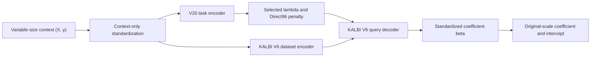
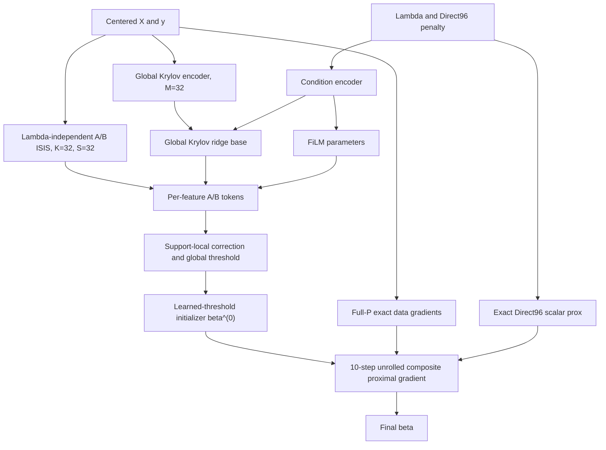
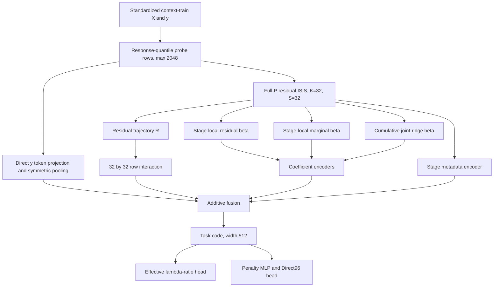

# KALBI V6 and Lambda Selector V20 Detailed Architecture

Date: 2026-07-24

## 문서 목적

이 문서는 현재 8-GPU 서버에서 joint training 중인 다음 두 구현을 실제
source code 기준으로 설명한다.

- coefficient estimator: KALBI V6
- lambda and penalty estimator: Lambda Selector V20

내부 구현을 분석할 때는 V6와 V20을 구분하지만, 논문 그림과 결과표에서는
둘을 결합한 전체 방법을 **KALBI**로 표기한다. `KALBI beta solver`,
`V20 selector`처럼 두 모델을 별도 방법으로 보이게 하는 표기는 사용하지
않는다.

이 문서는 배포 과정 중심의
[[Kalbi V6 Eta4x Iter10 and Y-Conditioned Selector Implementation and Launch 2026-07-23]]
및 사전 설계 문서
[[Kalbi V6 Eta4x Iter10 and Y-Conditioned Selector Plan 2026-07-23]]와
상호 보완적이다.

## 구현 식별 정보

### 서버와 source

- Server: `ssh -p 19508 root@175.155.64.224`
- Project root: `/users/minsuk/fm-lm-lambda`
- Package:
  `/users/minsuk/fm-lm-lambda/kalbi_v6_exactprox10_eta4x_v20y_k32s32_p100k_effbatch32`
- Production run:
  `/users/minsuk/fm-lm-lambda/runs/kalbi_v6_v20y_exactproxpg10_eta4x_tabiclv11_p100k_effbatch32_30k_20260723`
- Training log:
  `/users/minsuk/fm-lm-lambda/logs/kalbi_v6_v20y_exactproxpg10_eta4x_tabiclv11_p100k_effbatch32_30k_20260723/trainer.log`

### 버전 문자열

- KALBI V6:
  `kalbi_v6_krylov_abfilm_threshold_exactproxpg10_eta4x_k32_stages32_v1`
- Selector V20:
  `v20_k32s32_direct96_residualtrajectory_fullp_isis32x32_stagegain0p5pct_hidden512_probe2048_chunk4096_noreplacement_localres_localmarg_cumulativejointbeta_ylinear_meanstdmax_penalty_preln_reslinear3_nopostnorm_generalizedmaxslope_v2`
- Checkpoint:
  `kalbi_v6_v20y_k32s32_exactDirect96proxPG10_eta4x_tabiclv2_expvarnoise_v11_p100k_effbatch32_generalizedMaxSlope_checkpoint_v2`

### 현재 구현의 핵심 크기

| Component | Setting |
|---|---:|
| Krylov dimension | 32 |
| KALBI ISIS features per stage | 32 |
| KALBI ISIS stages | 32 |
| KALBI ISIS ridge | $10^{-6}$ |
| KALBI neural hidden width | 512 |
| KALBI refinement iterations | 10 |
| Coefficient bound | 6 |
| Selector ISIS features per stage | 32 |
| Selector ISIS stages | 32 |
| Selector probe rows | at most 2,048 |
| Selector feature scan chunk | 4,096 |
| Selector hidden width | 512 |
| Penalty grid | 96 points on $[0,6]$ |
| KALBI parameters | 3,588,547 |
| Selector parameters | 21,749,345 |

## 문제 정의

표준화되고 centered된 context data를

$$
X_c\in\mathbb R^{N\times P},\qquad
y_c\in\mathbb R^N
$$

라고 하자. KALBI가 근사하려는 coefficient objective는

$$
F(\beta;\lambda,\rho)
=
\frac{1}{2N}\lVert y_c-X_c\beta\rVert_2^2
+
\lambda\sum_{j=1}^{P}\rho(|\beta_j|)
$$

이며, 현재 Direct96 contract의 coefficient domain 때문에

$$
|\beta_j|\leq 6
$$

으로 제한한다.

전체 inference 목표는 가변 크기 $N,P$에 대해

$$
(X_c,y_c)
\longmapsto
\left(\widehat\lambda,\widehat\rho\right)
\longmapsto
\widehat\beta
$$

를 계산하는 것이다. V20이 $\widehat\lambda,\widehat\rho$를 출력하고,
V6가 같은 context data와 이 두 출력을 사용하여
$\widehat\beta$를 계산한다.

## Direct96 Penalty Contract

KALBI V6와 V20은 동일한 Direct96 penalty representation을 사용한다.
Penalty function은 별도 family label이나 SCAD/MCP candidate index가 아니라
96개의 연속 parameter로 직접 생성된다.

### Grid와 native representation

고정된 96-point nonuniform grid를

$$
0=t_0<t_1<\cdots<t_{95}=6
$$

으로 둔다. Grid는 0 근처에 더 조밀하며, 대략 절반은 $[0,0.3]$,
나머지는 $[0.3,6]$을 덮는다.

각 grid point에서

$$
\rho(t_i),\qquad \rho'(t_i)
$$

를 interleave하여 저장하고, 다음 네 metadata를 붙인다.

$$
\left[
\rho'(0),\,
\rho(1),\,
\rho'(6),\,
\operatorname{TV}(\rho')
\right].
$$

따라서 native penalty width는

$$
2\cdot 96+4=196
$$

이다.

### Direct96 decoder

V20의 Direct96 head는 먼저 96-dimensional unconstrained proposal
$\theta$를 출력한다. 첫 coordinate는 derivative intercept이고,
나머지 95 coordinates는 hinge-basis weight로 사용된다.

$$
d_{\mathrm{proposal}}(t)
=
\theta_0+
\sum_{k=0}^{94}\theta_{k+1}(t-t_k)_+.
$$

각 grid point의 derivative proposal에 stable squareplus를 적용하여
strict positivity를 만든다.

$$
d_+(t)
=
\epsilon_d+
\operatorname{squareplus}
\left(
d_{\mathrm{proposal}}(t)-\epsilon_d
\right),
\qquad
\epsilon_d=10^{-6}.
$$

그 후 전체 mass로 나누어

$$
\rho'(t)=
\frac{d_+(t)}
{\int_0^6d_+(u)\,du}
$$

로 정규화한다. 따라서

$$
\rho(0)=0,\qquad \rho(6)=1,\qquad \rho'(t)>0
$$

가 성립한다.

중요한 제한은 다음과 같다.

- $\rho'(t)>0$이므로 penalty는 증가 함수이다.
- Convexity는 강제되지 않는다.
- Concavity도 강제되지 않는다.
- 따라서 LASSO, SCAD, MCP, ridge-like shape뿐 아니라 derivative가
  증가와 감소를 반복하는 nonconvex shape도 표현할 수 있다.
- `derivative_floor=1e-6`은 mass normalization 이전 positivity map에
  적용되므로 최종 $\rho'$의 수치적 hard lower bound가 정확히
  $10^{-6}$이라는 뜻은 아니다. 최종 derivative가 strictly positive라는
  것이 실제 contract이다.

### Piecewise-quadratic penalty

Grid 사이에서 $\rho'$를 linear interpolation하므로 각 interval에서

$$
\rho'(t)=a_i t+b_i
$$

이고,

$$
\rho(t)
$$

는 정확한 piecewise-quadratic function이다. 이 구조 덕분에 V6는
일반적인 iterative root solver 없이 scalar proximal problem을 interval별
closed form으로 정확히 계산할 수 있다.

## KALBI V6

### 전체 계산 흐름

### 1. Dataset preprocessing

Model precompute 단계에서 다음을 계산한다.

$$
\widetilde X
=
X-\operatorname{mean}_{row}(X),
\qquad
\widetilde y
=
y-\operatorname{mean}(y).
$$

Training loader에서 이미 featurewise Z-scaling을 수행하지만, model은
intercept profiling을 위해 다시 centering한다.

$$
g_j
=
\frac{1}{N}\widetilde X_j^\top\widetilde X_j,
\qquad
c_j
=
\frac{1}{N}\widetilde X_j^\top\widetilde y,
$$

$$
\lambda_{\max}
=
\max_j |c_j|.
$$

Model은 $P\times P$ Gram matrix를 만들지 않고 다음 $O(P)$ statistics만
저장한다.

- `Xty`: $c\in\mathbb R^P$
- `gram_diag`: $g\in\mathbb R^P$
- `log_abs_Xty`
- `lambda_max`
- feature mask
- centered $X,y$, because A/B trajectory와 refinement에 필요하다.

### 2. Global Krylov encoder

Krylov basis는 sample space에서 만들어진다. 초기 vector는 centered
$y$이며, norm이 퇴화하면 rowwise feature energy를 fallback seed로
사용한다.

$$
q_0=\frac{y_c}{\lVert y_c\rVert_2}.
$$

각 단계에서

$$
\phi_m=\frac{1}{N}X_c^\top q_m\in\mathbb R^P,
$$

$$
w_{m+1}=X_c\phi_m
$$

을 계산하고, 이전 $q$들에 대해 두 번 reorthogonalization한다.
Dimension은 $M=32$이다.

Feature-space projected basis를

$$
\Phi=
\begin{bmatrix}
\phi_0^\top\\
\vdots\\
\phi_{M-1}^\top
\end{bmatrix}
\in\mathbb R^{M\times P}
$$

라고 하면 reduced matrix는

$$
T
=
N\Phi\Phi^\top
=
U^\top\frac{X_cX_c^\top}{N}U
\in\mathbb R^{M\times M}
$$

이고,

$$
U_y=U^\top y_c
$$

도 저장한다.

이 global Krylov component만 사용하면 $P\gg N$에서 output이
$\operatorname{row}(X)$의 제한된 subspace에 갇힌다. KALBI는 이를
A/B ISIS와 full-P refinement로 보완한다.

### 3. Lambda and penalty condition

Query마다 다음 여섯 lambda-related feature를 만든다.

1. clipped $\log(\lambda/\lambda_{\max})$
2. bounded $\sqrt{\lambda/\lambda_{\max}}$
3. $\tanh(\log\lambda_{\max}/5)$
4. clipped $\log(\lambda d_0/\lambda_{\max})$
5. $\tanh(d_0/2)$
6. $\log(\lambda+10^{-7})$

여기서

$$
d_0=\rho'(0).
$$

Native196 penalty는 residual MLP를 통해 256-dimensional shape code로
압축된다. Numeric lambda code와 shape code를 결합한 condition code의
width는 256이다. 현재 KALBI V6 condition encoder는 $N,P$ 자체를
numeric input으로 넣지 않는다.

A/B decoder를 위한 expanded penalty representation은

$$
[
\rho_{1:96},\,
\rho'_{1:96},\,
\lambda\rho_{1:96},\,
\lambda\rho'_{1:96},\,
\text{metadata}_4
]
\in\mathbb R^{388}
$$

이다. 여기에 여섯 lambda feature를 붙인 394-dimensional vector가
FiLM generator 입력이다.

구현상 compatibility tensor의 전체 width는 490이며 마지막 96 coordinates는
log-grid이다. 현재 `kalbi_ab_head`는 이 중 앞의 394 coordinates만
사용한다.

### 4. Global Krylov ridge base

Condition code에서 scalar

$$
s_\alpha=s_\alpha(\lambda,\rho)
$$

를 예측하고,

$$
\alpha
=
\lambda\exp(s_\alpha)+\epsilon
$$

를 만든다. Reduced ridge system은

$$
(T+\alpha I+\epsilon I)a=U_y
$$

이며 global base coefficient는

$$
\beta_{\mathrm{Krylov}}
=
\sum_{m=0}^{M-1}a_m\phi_m
$$

이다.

Base head는 width 256의 residual MLP이며, 마지막 scalar layer는
초기에는 zero-initialized되어 있다.

### 5. Lambda-independent A/B ISIS trajectory

V6의 A/B trajectory는 $\lambda$나 penalty function에 의존하지 않는다.
따라서 같은 dataset의 모든 lambda query가 정확히 같은 selected support를
사용한다. 이는 lambda에 따라 support가 불연속적으로 바뀌어 solution
path가 울퉁불퉁해지는 문제를 줄이기 위한 핵심 설계다.

설정은 다음과 같다.

- $K=32$ features per stage
- $S=32$ stages
- 최대 selected support $K S=1024$
- fixed ridge $10^{-6}$
- centered Pearson correlation screening
- deterministic top-k
- without-replacement selection
- trajectory construction은 `torch.no_grad()`

Stage $s$의 현재 residual을 $r_{s-1}$이라고 하면, 아직 선택되지 않은
feature마다

$$
\operatorname{score}_{j,s}
=
\frac{
\left|
N^{-1}X_{c,j}^\top
(r_{s-1}-\bar r_{s-1})
\right|
}{
\operatorname{RMS}(X_{c,j})
\operatorname{RMS}(r_{s-1}-\bar r_{s-1})
}
$$

를 계산하고 top-32 set $J_s$를 뽑는다.

#### A trajectory

새로 선택한 $J_s$만 사용하여 현재 residual에 ridge fit한다.

$$
a_s
=
\arg\min_a
\frac{1}{2N}
\lVert r_{s-1}-X_{J_s}a\rVert_2^2
+
\frac{10^{-6}}{2}\lVert a\rVert_2^2.
$$

이를 원래 $P$-dimensional coordinate에 scatter한 것이

$$
A_{:,s}\in\mathbb R^P
$$

이다. Screening residual은

$$
r_s=r_{s-1}-X_{J_s}a_s
$$

로 update된다.

#### B trajectory

누적 support

$$
\mathcal S_s=J_0\cup\cdots\cup J_s
$$

전체에서 original centered response $y_c$를 다시 ridge fit한다.

$$
b_s
=
\arg\min_b
\frac{1}{2N}
\lVert y_c-X_{\mathcal S_s}b\rVert_2^2
+
\frac{10^{-6}}{2}\lVert b\rVert_2^2.
$$

이를 $P$-dimensional coordinate에 scatter한 것이

$$
B_{:,s}\in\mathbb R^P
$$

이다.

최종 trajectory shape은

$$
A,B\in\mathbb R^{P\times 32}.
$$

주의할 점은 KALBI V6의 A/B trajectory에는 0.5% stage gain이 없다는
것이다. 0.5% stage gain은 뒤에서 설명할 V20 내부 trajectory에만
적용된다.

Ridge solve는 width와 $N$ 중 작은 쪽을 사용하여 primal 또는 dual
system을 선택한다. FP32 solve가 실패한 system만 FP64로 다시 만들고,
그래도 실패할 때만 machine-epsilon 수준의 jitter를 사용한다.

### 6. Per-feature A/B FiLM decoder

Feature $j$, query $q$마다 다음 69-dimensional token을 만든다.

$$
z_{j,q}
=
[
A_{j,1:32},\,
B_{j,1:32},\,
c_j,\,
g_j,\,
\log|c_j|,\,
\mathbf 1(j\in\mathcal S),\,
\beta_{\mathrm{Krylov},j,q}
].
$$

즉,

$$
2S+5=69.
$$

Decoder 구조는 다음과 같다.

- input projection: $69\rightarrow512$
- three width-512 residual blocks
- 각 residual block에 query-specific FiLM 적용
- FiLM generator:
  $394\rightarrow512\rightarrow3072$
- output:
  $512\rightarrow2$

두 output channel은 다음 의미를 갖는다.

1. support-local coefficient correction
2. featurewise log threshold multiplier

Correction은 A/B ISIS support에 mask되지만, threshold multiplier는 모든
$P$개 feature에 대해 출력된다. 따라서 dense Krylov tail도 정확히
0으로 만들 수 있다.

### 7. Learned terminal threshold initializer

Featurewise base threshold는

$$
\tau^{\mathrm{base}}_{j,q}
=
\frac{\lambda_q d_{0,q}}{\max(g_j,10^{-4})}.
$$

Neural decoder가 출력한 log multiplier를

$$
\ell_{j,q}\in[-6,6]
$$

로 clamp하고,

$$
\tau_{j,q}
=
\tau^{\mathrm{base}}_{j,q}\exp(\ell_{j,q})
$$

를 사용한다.

Pre-threshold coefficient는

$$
u_{j,q}
=
\beta_{\mathrm{Krylov},j,q}
+
\Delta\beta_{j,q}^{A/B}
$$

이고, initializer는

$$
\beta^{(0)}_{j,q}
=
\operatorname{sign}(u_{j,q})
\max(|u_{j,q}|-\tau_{j,q},0).
$$

마지막으로 $[-6,6]$에 clamp한다.

이 단계의 soft-thresholding은 최종 penalty prox를 근사하는 유일한
연산이 아니다. 이는 좋은 sparse starting point를 만드는 learned
initializer이고, 그 뒤에 실제 Direct96 penalty의 exact scalar prox를
사용하는 10-step refinement가 이어진다.

### 8. Ten-step exact composite proximal-gradient refinement

Initializer를

$$
\beta^{(0)}
$$

라고 하면, $t=0,\ldots,9$에서

$$
r^{(t)}=X_c\beta^{(t)}-y_c,
$$

$$
\nabla f(\beta^{(t)})
=
\frac{1}{N}X_c^\top r^{(t)}
$$

를 full $P$에 대해 다시 계산한다.

Update는

$$
z^{(t)}
=
\beta^{(t)}-\eta_t\nabla f(\beta^{(t)}),
$$

$$
\beta^{(t+1)}
=
\operatorname{prox}_{\eta_t\lambda\rho}
\left(z^{(t)}\right)
$$

이다.

#### Initial eta candidate

Reduced Krylov Ritz maximum과 full-P Gram diagonal maximum을 사용한다.

$$
L_{\mathrm{init}}
=
\max
\left\{
0.5\,\lambda_{\max}(T),
\max_j g_j
\right\},
$$

$$
\eta_{\mathrm{init}}
=
\frac{0.95}{L_{\mathrm{init}}}.
$$

`0.5`는 eta sweep에서 정의한 eta4x initial-candidate convention이다.
기존 safety 2.0을 0.5로 바꾼 것이며, 최종 accepted eta를 무조건 네 배
곱한다는 뜻은 아니다.

#### Negative-curvature cap

각 Direct96 interval에서

$$
\rho''(t)=a_i
$$

이고, 가장 큰 negative curvature magnitude를

$$
\kappa
=
\max_i(-a_i,0)
$$

라고 한다. Scalar prox가 interval마다 strongly convex하도록

$$
\eta_t
\leq
\frac{0.9}{\lambda\kappa}
$$

를 강제한다. 이에 따라

$$
1+\eta_t\lambda\rho''(t)\geq0.1.
$$

#### Directional majorization and backtracking

Prox candidate와 현재 coefficient 차이를

$$
\delta=\beta_{\mathrm{candidate}}-\beta^{(t)}
$$

라고 하면

$$
\eta_t
\frac{\lVert X_c\delta\rVert_2^2/N}
{\lVert\delta\rVert_2^2}
\leq0.95
$$

인지 검사한다.

- 실패하면 eta를 0.5배로 줄인다.
- 최대 6회 backtracking한다.
- 그래도 해결되지 않으면
  $$
  L_{\mathrm{trace}}=\sum_jg_j
  $$
  를 사용하는 conservative fallback으로 바꾼다.

Eta 선택, backtracking branch 및 interval index는 detached discrete
decision이다. 선택된 branch 내부의 beta, lambda, penalty values에는
ordinary autograd가 흐른다.

#### Exact Direct96 scalar prox

$$
\gamma=\eta_t\lambda,\qquad u=|z_j|
$$

라고 하자. Prox optimality equation은

$$
t+\gamma\rho'(t)=u,\qquad 0\leq t\leq6
$$

이다.

Grid knot에서

$$
h_i=t_i+\gamma\rho'(t_i)
$$

를 계산한 뒤 `searchsorted`로 interval을 찾는다. Interval $i$에서

$$
\rho'(t)=a_i t+b_i
$$

이므로 stationary point는

$$
t^*
=
\frac{u-\gamma b_i}{1+\gamma a_i}
$$

로 closed form 계산된다.

- $u<h_0=\gamma\rho'(0)$이면 exact zero
- 내부 interval이면 위 closed-form solution
- upper domain을 넘으면 $t=6$
- 마지막으로 원래 sign을 복원

따라서 현재 penalty representation에 대해서는 heuristic
soft-threshold approximation이 아니라 exact bounded scalar prox다.

### 9. Differentiability

다음 경로에는 gradient가 흐른다.

- condition encoder
- Krylov ridge alpha head
- A/B FiLM correction head
- learned threshold multiplier
- ten unrolled beta states
- selected interval 안의 Direct96 $\rho,\rho'$
- lambda

다음 연산은 discrete 또는 `no_grad`이다.

- Krylov basis construction
- A/B ISIS feature indices
- A/B fixed-ridge trajectory
- eta/backtracking selection
- prox interval selection

따라서 V6는 fully differentiable optimizer가 아니라, discrete geometry
construction 위에 continuous neural decoder와 piecewise differentiable
10-step solver를 결합한 구조다.

### 10. Matrix-free 계산

V6는 어떤 단계에서도 $P\times P$ matrix를 만들지 않는다.

- Krylov: $X^\top q$, $X\phi$
- ISIS: selected $K$ 또는 $Ks$ columns의 작은 ridge system
- refinement: $X\beta$, $X^\top r$
- prox: feature chunk 4,096
- neural A/B head: feature chunk 2,048

Refinement의 지배 비용은 대략

$$
O(TQNP),\qquad T=10
$$

이다. Beta training에서는 한 task에 $Q=32$ random
lambda-penalty queries를 동시에 사용한다. V20-selected inference에서는
일반적으로 $Q=1$이다.

## Lambda Selector V20

### 역할

V20은 KALBI의 coefficient output이나 candidate penalty set을 입력으로
받지 않는다. 입력은 standardized context-train

$$
(X_{\mathrm{train}},y_{\mathrm{train}})
$$

뿐이다. 출력은 다음 두 개다.

1. scalar effective lambda ratio
2. 하나의 continuous Direct96 penalty function

Held-out $y$는 selector input으로 사용하지 않고 training loss 계산에만
사용한다.

### 전체 계산 흐름

### 1. Train-only split and standardization

Selector update마다 한 task의 rows를 random permutation한 뒤 절반씩
context-train과 held-out로 나눈다.

$$
N_{\mathrm{train}}=\lfloor N/2\rfloor.
$$

다음 statistics는 context-train에서만 계산한다.

$$
\mu_{X,j},\quad\sigma_{X,j},\quad\mu_y,\quad\sigma_y.
$$

같은 statistics를 held-out $X,y$에 적용한다. Variance가 거의 0인
feature는 0으로 mask한다.

V20에는 standardized context-train $X,y$만 들어간다. Held-out
$X,y$는 V20이 출력한 lambda와 penalty로 KALBI coefficient를 계산한
후 prediction loss를 평가할 때만 사용된다.

### 2. Probe-row selection

Selector의 row-dependent 계산은 최대 2,048개 probe row에서 수행한다.

- $N_{\mathrm{train}}\leq2048$: 모든 row 사용
- $N_{\mathrm{train}}>2048$: $y$를 정렬하고 response quantile에
  해당하는 row를 거의 균등하게 선택

따라서 fixed $N$ padding이나 row attention이 필요하지 않으며,
row ordering에 의존하지 않는 representation을 목표로 한다.

### 3. Full-P residual ISIS

V20은 fixed candidate pool을 사용하지 않는다. 매 stage마다 아직
선택되지 않은 모든 valid feature를 현재 residual과 다시 비교한다.
Feature dimension은 4,096-column chunk로 scan하지만, running global
top-k를 유지하므로 결과는 full $P$ score matrix를 한 번에 만든
경우와 같다.

Probe rows에서 feature를 다시 center하고 scale한 뒤

$$
\operatorname{score}_{j,s}
=
\frac{
|\langle x_j,r_{s-1}\rangle|/N_{\mathrm{probe}}
}{
\sqrt{\langle x_j,x_j\rangle/N_{\mathrm{probe}}}
\operatorname{RMS}(r_{s-1})
}
$$

를 사용한다.

- $K=32$
- $S=32$
- 이전 stage의 feature는 영구 mask
- maximum selected slots는 1,024
- all $P$ features are rescored at every stage

### 4. Stage-local residual and marginal ridge coefficients

Stage $s$에서 선택한 32개 feature의 standardized Gram을
$G_s$라고 하자. Ridge parameter는 fixed $10^{-6}$이 아니라

$$
\alpha_s
=
\max
\left(
10^{-3}\,
\operatorname{mean}\operatorname{diag}(G_s),
10^{-5}
\right)
$$

이다.

같은 system으로 두 coefficient를 계산한다.

#### Residual coefficient

$$
\beta_s^{\mathrm{res}}
=
(G_s+\alpha_s I)^{-1}
\frac{X_s^\top r_{s-1}}{N_{\mathrm{probe}}}.
$$

이 coefficient로 screening residual을 update한다.

#### Marginal coefficient

$$
\beta_s^{\mathrm{marg}}
=
(G_s+\alpha_s I)^{-1}
\frac{X_s^\top y}{N_{\mathrm{probe}}}.
$$

이는 residual update에는 쓰이지 않고 task representation에만 들어간다.

두 trajectory shape은

$$
B_{\mathrm{res}},B_{\mathrm{marg}}
\in\mathbb R^{32\times32}.
$$

### 5. Residual trajectory and 0.5% stage gain

각 stage 후 probe residual을 column으로 쌓아

$$
R_{\mathrm{raw}}
\in
\mathbb R^{N_{\mathrm{probe}}\times32}
$$

를 만든다. Response sign convention을 맞추기 위해 raw residual에
$\operatorname{sign}(y)$를 곱한다.

Stage gain은

$$
g_s=1.005^s,\qquad s=0,\ldots,31
$$

이다. 마지막 stage의 gain은 약 1.167이다.

다음 네 trajectory에 post-hoc으로 동일하게 적용한다.

- residual $R$
- residual coefficient $B_{\mathrm{res}}$
- marginal coefficient $B_{\mathrm{marg}}$
- cumulative coefficient $B_{\mathrm{cum}}$

이 scaling은 residual screening 과정 자체를 바꾸지 않는다. 모든 feature
선택과 residual update가 끝난 후 representation scale에만 적용된다.

### 6. Cumulative joint-ridge branch

선택 순서대로 최대 1,024개 feature slot을 만든다. Stage $s$에서는
첫 $32(s+1)$개 selected feature 전체로 original standardized $y$를
joint ridge refit한다.

$$
\beta_s^{\mathrm{cum}}
=
\arg\min_b
\frac{1}{2N_{\mathrm{probe}}}
\lVert y-X_{\mathcal S_s}b\rVert_2^2
+
\frac{\alpha_{\mathrm{cum}}}{2}\lVert b\rVert_2^2.
$$

$\alpha_{\mathrm{cum}}$은 전체 selected-column diagonal에서 task별로
한 번 정하고, 모든 prefix stage에서 동일하게 사용한다.

매 stage마다 growing system을 처음부터 풀지 않고 exact block-Cholesky
expansion을 사용한다. 각 prefix coefficient를 1,024 slots에 zero-padding하여

$$
B_{\mathrm{cum}}
\in
\mathbb R^{1024\times32}
$$

를 만든다.

이 cumulative refit은 representation branch일 뿐이며, 다음 stage
screening에 사용되는 residual을 바꾸지 않는다. Screening residual은
stage-local $\beta_s^{\mathrm{res}}$만 사용한다.

### 7. Residual interaction encoder

Stage gain과 active mask를 적용한 residual row

$$
R_i\in\mathbb R^{32}
$$

마다 두 개의 residual MLP를 적용한다.

$$
q_i=f_q(R_i),\qquad k_i=f_k(R_i),
$$

각 map은

$$
32\rightarrow512\rightarrow32
$$

의 two-linear residual map이다.

Row interaction은

$$
A_R
=
\frac{1}{N_{\mathrm{probe}}}
\sum_iq_i k_i^\top
\in\mathbb R^{32\times32}.
$$

이를 flatten한 1,024-vector를

$$
1024\rightarrow512
$$

로 project하여 `interaction_code`를 만든다. 이 연산은
$N_{\mathrm{probe}}^2$ attention을 사용하지 않는다.

### 8. Coefficient encoders

세 coefficient branch를 각각 flatten하고 LayerNorm plus Linear로
512-dimensional code로 만든다.

$$
B_{\mathrm{res}}:
1024\rightarrow512,
$$

$$
B_{\mathrm{marg}}:
1024\rightarrow512,
$$

$$
B_{\mathrm{cum}}:
32768\rightarrow512.
$$

세 code를 concatenate한 뒤

$$
1536\rightarrow512
$$

projection을 적용하여 `coefficient_code`를 만든다.

V20 parameter의 대부분은
$$
32768\rightarrow512
$$
cumulative projection에서 발생한다.

### 9. Stage metadata encoder

각 32개 stage에 대해 다음 세 coordinate를 사용한다.

1. stage active mask
2. $\log(\operatorname{RMS}(r_{s-1}))$
3. stage explained fraction

따라서 metadata width는

$$
3S=96
$$

이고,

$$
96\rightarrow512
$$

projection으로 `metadata_code`를 만든다.

### 10. Direct y-conditioning branch

V20이 V19에서 추가한 핵심 branch다. Residual trajectory에 사용한 것과
정확히 같은 probe indices에서 standardized context-train $y_i$를
가져온다.

각 scalar response를

$$
z_i
=
\operatorname{GELU}(W_y y_i+b_y)
\in\mathbb R^{512}
$$

로 project한다.

Row dimension에 대해 permutation-symmetric pooling을 수행한다.

$$
p_y
=
[
\operatorname{mean}_i z_i,\,
\operatorname{std}_i z_i,\,
\operatorname{max}_i z_i
]
\in\mathbb R^{1536}.
$$

Population standard deviation을 사용하며,

$$
h_y=W_p p_y+b_p\in\mathbb R^{512}
$$

로 project한다.

- fixed $N$ 불필요
- attention 없음
- complexity $O(N_{\mathrm{probe}}\cdot512)$
- held-out $y$ 접근 불가
- `response_pool_projection`은 V19 behavior를 초기에는 크게 바꾸지
  않도록 standard deviation $10^{-3}$의 small nonzero weight로 초기화

### 11. Fusion trunk

네 code를 elementwise sum한다.

$$
h_0
=
h_{\mathrm{interaction}}
+
h_{\mathrm{coefficient}}
+
h_{\mathrm{metadata}}
+
h_y.
$$

이후 width-512 three-linear residual MLP를 적용한다.

$$
h_{\mathrm{task}}
=
\operatorname{FusionMLP}(h_0)
\in\mathbb R^{512}.
$$

### 12. Lambda head

Scalar logit을

$$
z_\lambda=W_\lambda h_{\mathrm{task}}+b_\lambda
$$

로 출력하고,

$$
u=\operatorname{sigmoid}(z_\lambda)
$$

를 이용해 log scale에서 interpolate한다.

$$
r
=
\exp
\left[
\log r_{\min}
+u(\log r_{\max}-\log r_{\min})
\right],
$$

$$
r_{\min}=10^{-6},\qquad r_{\max}=1.
$$

Lambda head는 초기 effective ratio가 0.1이 되도록 초기화된다.

### 13. General-penalty lambda scale

V19까지는

$$
r=\frac{\lambda\rho'(0)}{\lambda_{\max}}
$$

를 사용했다. 이는 LASSO-like nonsmooth penalty에는 자연스럽지만,
ridge-like penalty에서

$$
\rho'(0)\simeq0
$$

이면 lambda를 정의할 수 없다.

V20은 reference slope를

$$
s(\rho)
=
\max_{0\leq t\leq6}\rho'(t)
$$

로 바꾸고,

$$
r
=
\frac{\lambda s(\rho)}{\lambda_{\max}},
$$

$$
\widehat\lambda
=
\frac{r\lambda_{\max}}{s(\rho)}
$$

를 사용한다.

장점은 다음과 같다.

- Direct96는 $\rho(6)=1$이고 $\rho'>0$이므로 $s(\rho)>0$
- ridge-like $d_0\simeq0$ penalty도 허용
- LASSO, SCAD, MCP처럼 derivative가 감소하는 penalty에서는
  $s(\rho)=d_0$이므로 이전 정의와 동일

그러나 중요한 한계가 있다. Zero solution의 origin KKT scale은

$$
\frac{\lambda d_0}{\lambda_{\max}}
=
r\frac{d_0}{s(\rho)}.
$$

따라서

$$
d_0\ll s(\rho)
$$

인 smooth 또는 increasing-derivative penalty에서는 $r\leq1$이어도
zero solution에 필요한 regularization에 도달하지 못할 수 있다.
이는 현재 KALBI-selected solution이 CV LASSO보다 훨씬 dense해질 수 있는
구조적 원인 중 하나다.

`max rho'` scaling은 ridge-like penalty를 지원하는 올바른 일반화지만,
현재 ratio range $[10^{-6},1]$가 모든 penalty shape에서 동일한
sparsity range를 보장하지는 않는다.

### 14. Penalty head

Task code에서 penalty branch는 다음을 수행한다.

1. width-512 pre-norm Linear-GELU residual block 3개
2. final post-residual LayerNorm 없음
3. $512\rightarrow96$ Direct96 linear head
4. 300,000-penalty cache의 coordinatewise mean과 standard deviation으로
   proposal scale 복원
5. shared canonical Direct96 builder로 positivity와 $\rho(6)=1$ 적용

Penalty candidate family를 고르지 않고 penalty function 자체를 연속적으로
출력한다.

### 15. V20 differentiability

V20의 full-P ISIS, ridge trajectories 및 probe-row selection은
`torch.no_grad()`로 계산된다. 이 부분에는 trainable parameter가 없으며,
그 결과를 compress하는 neural modules와 lambda/penalty heads만 학습된다.

Selector update에서는 KALBI V6 parameter를 freeze하지만,

$$
(\widehat\lambda,\widehat\rho)
\rightarrow
\widehat\beta_{\mathrm{KALBI}}
\rightarrow
\text{held-out prediction}
$$

경로의 autograd graph는 유지한다. 따라서 held-out prediction loss의
gradient가 V6의 threshold 및 10-step exact prox를 통과하여 V20의 lambda
head와 Direct96 head까지 전달된다.

## Joint Training

### Beta-model update

각 variable-shape rolling task는 전체 row를 taskwise Z-scale한다. 한 task에서

- 4 random Direct96 penalties
- penalty마다 8 random lambdas
- 총 32 queries

를 한 번에 평가한다.

각 query의 objective는

$$
\widehat F
=
\frac{1}{2N}\lVert y-X\widehat\beta\rVert_2^2
+
\lambda\sum_j\rho(|\widehat\beta_j|)
$$

이고, zero coefficient objective는

$$
F_0=\frac{1}{2N}\lVert y\rVert_2^2.
$$

학습 loss는

$$
\mathcal L_{\beta}
=
\operatorname{mean}
\left[
\log
\left(
1+\frac{\widehat F}{F_0}
\right)
\right].
$$

KKT top-32는 logging diagnostic일 뿐 loss에 들어가지 않는다.

### Selector update

Selector는 beta update 네 번마다 한 번 update된다.

1. 새로운 task를 context-train과 held-out으로 절반 split
2. context-train statistics로 양쪽을 표준화
3. V20이 context-train $X,y$로 lambda와 penalty 출력
4. frozen KALBI V6가 context-train에서 coefficient 계산
5. held-out $X$에서 prediction
6. held-out $y$로 loss 계산

$$
\operatorname{MSE}_{\mathrm{heldout}}
=
\frac{1}{N_{\mathrm{test}}}
\lVert
X_{\mathrm{test}}\widehat\beta-y_{\mathrm{test}}
\rVert_2^2,
$$

$$
\mathcal L_{\mathrm{selector}}
=
\operatorname{mean}
\left[
\log
\left(
1+\frac{\operatorname{MSE}_{\mathrm{heldout}}}{2}
\right)
\right].
$$

Selector loss에는 다음이 없다.

- lambda teacher
- oracle-lambda supervision
- penalty family label
- ranking loss
- KKT loss
- penalty diversity regularizer
- sparsity regularizer

즉, lambda와 penalty는 held-out prediction performance만으로 joint
identification된다.

### DDP와 optimizer

Production launch 기준:

| Item | Setting |
|---|---:|
| GPUs | 8 |
| task batch per rank | 1 |
| beta gradient accumulation | 4 |
| selector gradient accumulation | 4 |
| global effective task batch | 32 |
| beta update frequency | every step |
| selector update frequency | every 4 beta steps |
| beta optimizer | AdamW |
| beta LR | $10^{-4}$ |
| beta weight decay | $10^{-4}$ |
| beta betas | $(0.9,0.95)$ |
| beta warmup | 500 steps |
| beta schedule | cosine |
| selector optimizer | AdamW |
| selector shared LR | $3\times10^{-4}$ |
| penalty MLP and Direct96 head LR | $3\times10^{-4}$ |
| selector weight decay | 0 |

Model outer forward는 BF16 autocast를 사용하지만, 다음 numerical core는
FP32다.

- Krylov reduced solve
- A/B ridge solve
- Direct96 exact prox
- ten-step refinement states
- objective and telemetry

### Initialization

현재 run은 scratch training이 아니다.

Source checkpoint:

`/users/minsuk/fm-lm-lambda/runs/kalbi_v3_v19cumbeta_tabiclv11_expvarnoise_p100k_effbatch32_30k_20260723/checkpoint_step023800.pt`

Initialization은 다음과 같다.

- KALBI V6 trainable state:
  compatible KALBI V3 coefficient-model weights에서 strict import
- V6 refinement:
  trainable parameter가 없으므로 새 parameter 없음
- V20 shared state:
  V19에서 strict shared-key import
- V20 response branch:
  네 개의 새로운 state tensor만 fresh initialization
- beta optimizer:
  fresh
- selector optimizer:
  fresh
- run counter:
  0부터 시작

따라서 이는 exact resume가 아니라 transferred initialization이다.

## Parameter Counts

### KALBI V6

| Module | Parameters |
|---|---:|
| Condition embedding | 781,484 |
| Global ridge alpha head | 199,169 |
| A/B FiLM correction and threshold head | 2,607,894 |
| Krylov builder | 0 |
| **Total** | **3,588,547** |

A/B head 내부:

| Submodule | Parameters |
|---|---:|
| $69\rightarrow512$ input projection | 35,840 |
| Three $512\rightarrow512$ layers | 787,968 |
| LayerNorms | 4,096 |
| $512\rightarrow2$ output | 1,026 |
| $394\rightarrow512\rightarrow3072$ FiLM generator | 1,778,964 |

### Lambda Selector V20

| Module | Parameters |
|---|---:|
| Row query map | 33,440 |
| Row key map | 33,440 |
| Residual interaction projection | 526,848 |
| Residual coefficient projection | 526,848 |
| Marginal coefficient projection | 526,848 |
| Cumulative coefficient projection | 16,843,264 |
| Three-code coefficient fusion | 790,016 |
| Stage metadata projection | 49,856 |
| Response token projection | 1,024 |
| Response pooled projection | 786,944 |
| Fusion MLP | 790,016 |
| Lambda head | 513 |
| Penalty MLP | 791,040 |
| Direct96 head | 49,248 |
| **Total** | **21,749,345** |

Cumulative trajectory flatten projection 하나가 V20 전체 parameter의 약
77%를 차지한다. 따라서 향후 selector size를 줄이려면 단순히 hidden
width보다

$$
B_{\mathrm{cum}}\in\mathbb R^{(KS)\times S}
$$

를 flatten하여 바로 Linear에 넣는 방식을 먼저 바꾸는 것이 효과적이다.

## Variable-Size Property

### KALBI V6

- Krylov width 32는 fixed
- ISIS K/S는 fixed
- feature decoder는 shared per-feature MLP
- refinement는 matrix-free
- 따라서 neural parameter shape는 $N,P$와 무관

### V20

- probe rows는 symmetric pooling으로 variable $N$ 처리
- full-P scan은 shared score computation으로 variable $P$ 처리
- selected trajectory는 fixed $K=32,S=32$ representation으로 압축
- attention matrix $N\times N$, $P\times P$, $N\times P$ token
  attention을 만들지 않음

다만 V20의 full-P residual ISIS는 매 stage마다 모든 feature를 rescore하므로
계산량은 대략

$$
O(SN_{\mathrm{probe}}P)
$$

이다. Parameter size는 $P$와 무관하지만 runtime은 $P$에 선형이고
stage 수에도 선형이다.

## Original-Scale Recovery

Context training statistics를

$$
\mu_{X,j},\sigma_{X,j},\mu_y,\sigma_y
$$

라고 하고 standardized coefficient를 $\widehat\beta^{\mathrm{std}}$라고
하면 original-scale coefficient는

$$
\widehat\beta_j^{\mathrm{orig}}
=
\frac{\sigma_y}{\sigma_{X,j}}
\widehat\beta_j^{\mathrm{std}}
$$

이다.

Intercept는

$$
\widehat b_0
=
\mu_y-
\sum_j\mu_{X,j}\widehat\beta_j^{\mathrm{orig}}
$$

로 복원한다. Variance가 0으로 mask된 feature는 coefficient 0을 유지한다.

## 현재 구조의 강점

1. $N,P$가 가변이어도 trainable layer shape가 변하지 않는다.
2. $P\times P$ matrix나 quadratic attention을 사용하지 않는다.
3. Lambda-independent ISIS support로 solution-path discontinuity를 줄인다.
4. Global Krylov base와 sparse coordinate trajectory를 동시에 사용한다.
5. Exact full-P gradient refinement가 ISIS support 밖 feature도 update할 수 있다.
6. Direct96 represented penalty에 대해 exact bounded scalar prox를 사용한다.
7. Selector가 penalty candidate family 없이 penalty function 자체를 출력한다.
8. Held-out prediction loss가 lambda와 penalty를 end-to-end로 학습한다.
9. Ridge-like $d_0\simeq0$ penalty도 generalized max-slope scaling으로
   처리한다.

## 현재 구조의 한계와 해석

### 1. Ten-step refinement는 converged optimizer가 아니다

각 refinement step은 curvature-safe exact prox와 data majorization을
사용하지만 10회만 수행한다. 따라서 composite objective를 줄이는
deterministic correction이지 exact global solution을 보장하지 않는다.
특히 nonconvex Direct96 penalty에서는 global optimum guarantee가 없다.

### 2. Discrete ISIS support는 학습되지 않는다

V6와 V20의 feature selection 및 ridge trajectory는 `no_grad`다. Neural
network는 선택 rule 자체를 바꾸지 못하며, 선택된 geometry를 해석하는
부분만 학습한다.

### 3. KALBI sparse initializer support는 최대 1,024개다

A/B correction은 최대 1,024-feature support에만 존재한다. Global Krylov
base와 full-P PG refinement가 support 밖을 보완하지만, 10회 iteration
안에 weak feature를 충분히 회복하지 못할 수 있다.

### 4. V20 probe approximation

$N>2048$에서는 full rows가 아니라 response-quantile probe만 사용한다.
Tail behavior와 rare subgroup geometry가 probe에 충분히 반영되지 않을 수
있다.

### 5. V20 cumulative branch가 매우 크다

21.75M parameters 중 16.84M이 cumulative flatten projection이다. 이
projection은 trajectory locality와 stage structure를 명시적으로 활용하지
않고 하나의 dense Linear로 압축한다.

### 6. Max-slope lambda scale와 sparsity range

$$
r=\lambda\max\rho'/\lambda_{\max}
$$

는 smooth penalty를 허용하지만

$$
\lambda\rho'(0)/\lambda_{\max}
$$

범위를 통일하지 않는다. $d_0/\max\rho'$가 작은 penalty는 selector
ratio 상한 1에서도 zero-KKT point에 도달하지 못한다. Lambda scaling을
일반 penalty에 맞게 확장한 것과, 모든 penalty에서 동일 sparsity range를
보장하는 것은 별개의 문제다.

### 7. Selector objective의 identifiability

Held-out MSE만 사용하면 서로 다른 $(\lambda,\rho)$ 조합이 비슷한
prediction을 만들 수 있다. 현재는 penalty diversity, sparsity 또는
shape regularization이 없으므로 penalty collapse나 task 간 유사한
penalty output이 발생할 수 있다.

### 8. Direct96는 concavity를 보장하지 않는다

Penalty derivative는 positive지만 monotone decreasing일 필요가 없다.
따라서 `sparsity penalty`라는 용어만으로 SCAD/MCP-like behavior를
가정하면 안 된다. 실제 $\rho,\rho'$, $d_0$, $\max\rho'$, derivative
TV를 함께 확인해야 한다.

## 핵심 Telemetry

V6는 query마다 10-iteration path를 기록한다.

- accepted eta
- $\gamma=\eta\lambda$
- penalty negative curvature $\kappa$
- minimum curvature denominator
- curvature step cap
- initial and trace Lipschitz estimates
- directional majorization ratio
- backtrack count
- trace fallback indicator
- data-gradient RMS
- exact-zero threshold
- coefficient-change RMS
- active fraction
- saturation fraction
- data loss before/after
- penalty before/after
- composite objective before/after
- objective delta

V20 training은 다음을 별도로 기록한다.

- selector objective
- raw held-out MSE
- selected effective lambda ratio
- selected lambda
- $d_0$
- $\max\rho'$
- ridge-like fraction
- $\rho(6)$ error
- penalty batch diversity
- beta nonzero fraction
- V20 response-branch gradient norms
- penalty MLP and Direct96 head gradient norms

## 논문 표기 규칙

논문 figure와 table에서는 다음을 사용한다.

- 전체 방법: `KALBI`
- selected lambda marker: `KALBI-selected lambda`
- numerical reference: `Coordinate descent reference`
- oracle marker: `Oracle lambda`

다음 표기는 내부 ablation이나 architecture appendix가 아니면 사용하지
않는다.

- `KALBI V6 beta solver`
- `V20 selector`
- `V20 selected`
- `beta solver output`
- `selector output`

Version과 checkpoint step은 figure legend가 아니라 reproducibility
manifest와 caption의 implementation detail에 기록한다.

## Reproducibility Paths and Hashes

### Core source

- `model.py`
  - SHA-256:
    `619617ec362f010e2403df09cffb9d582073bd12a4ef5ae732674ae69ab4de3c`
- `utils.py`
  - SHA-256:
    `c831495589137bd0cfdef377b64d4598045a27941e3524ae6d972c819e879a51`
- `exact_direct96_prox.py`
  - SHA-256:
    `2aae8b022e09dac7c734a4ef4d0b43318278dff3dd9e161e3c1e77ad1605a48d`
- `selector_v19_k32s32.py`
  - SHA-256:
    `a849a84632b3e0e01eaa2d79e40b0269aa44180b6e7d30bdb7d1576ad1b1a165`
- `selector_v20_yconditioned.py`
  - SHA-256:
    `af6634902a2061434b761db3f8d7b3f4950289df0b2f6652ac45f0373fd137a6`
- `canonical_penalty.py`
  - SHA-256:
    `ce51395d52a2692f48b2933fc224e32fe66664eafa16bb5ae19da679a32fe3b6`
- production trainer
  - SHA-256:
    `a75d4e8846fb8e4af0127382ecbec6cb77353339dde9f26610d2177de05c56de`

### Penalty cache

- Path:
  `/users/minsuk/fm-lm-lambda/penalty_cache_300k_v12_canonical_final.pt`
- SHA-256:
  `6a3fda8201de87d5e2078e6e56ad0c67e5ad2a27248865910cac8f0f36bfe1dc`

### Rolling data

- Root:
  `/users/sync_data/kalbi_tabiclv2_scm2048_qfilter_bnn128_expvarnoise_v11_p100k_100GB_seed88076430`
- Generator:
  TabICLv2 graph-SCM 2,048-base-feature plus BNN-128 expansion and
  featurewise exponential-variance noise
- Maximum $P$: 100,000
- Active catalog target: approximately 100 GB
- TabPFN-v1 tasks are not used in the current run.

### Backup

- iCloud:
  `/Users/minsuk.shin/Library/Mobile Documents/com~apple~CloudDocs/Projects/FM-LM/backups/kalbi_v6_v20y_eta4x_iter10_20260723`
- Backup files are covered by a verified `SHA256SUMS` manifest.

## Implementation Snapshot

문서 작성 시점인 2026-07-24에 확인한 상태:

- trainer supervisor: `RUNNING`
- rolling curator: `RUNNING`
- rolling producers: 16/16 `RUNNING`
- latest observed training update: step 5,470
- 확인 당시 latest complete checkpoint: step 5,400
- recent average compute time: approximately 4.2 seconds per training step,
  including the amortized selector updates

이 snapshot은 architecture contract가 아니라 운영 시점 기록이다. 이후
step과 checkpoint는 계속 증가한다.
